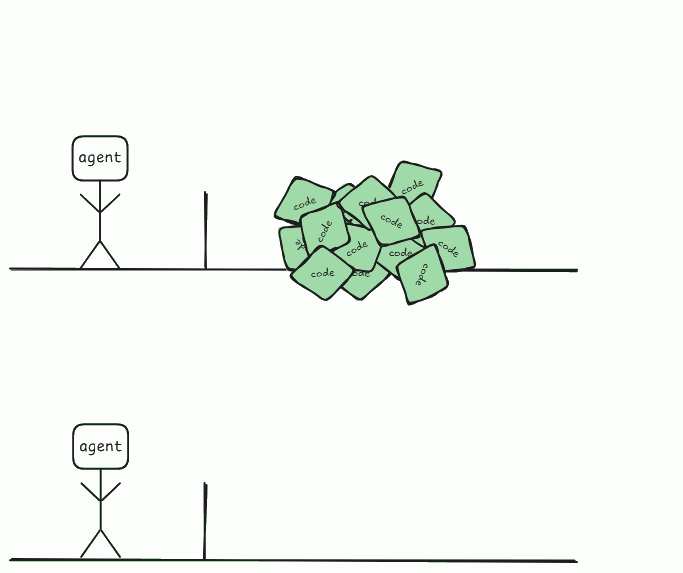
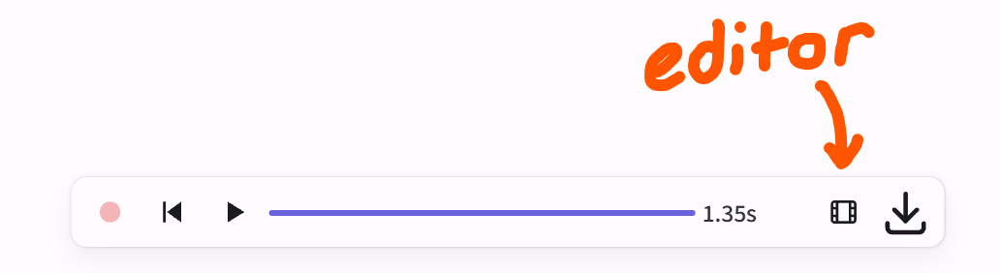
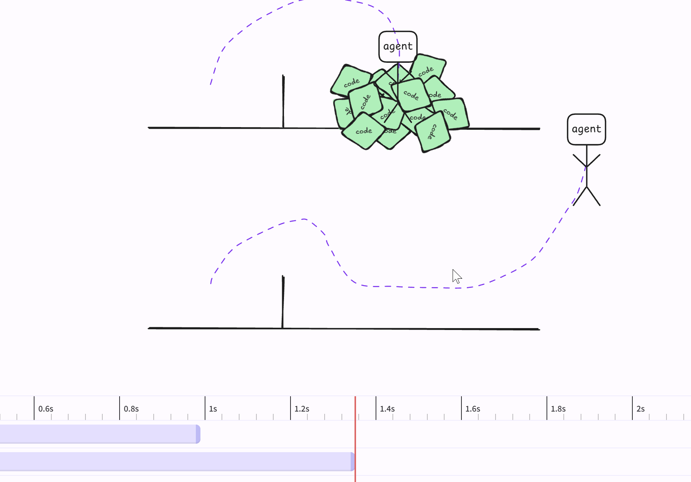
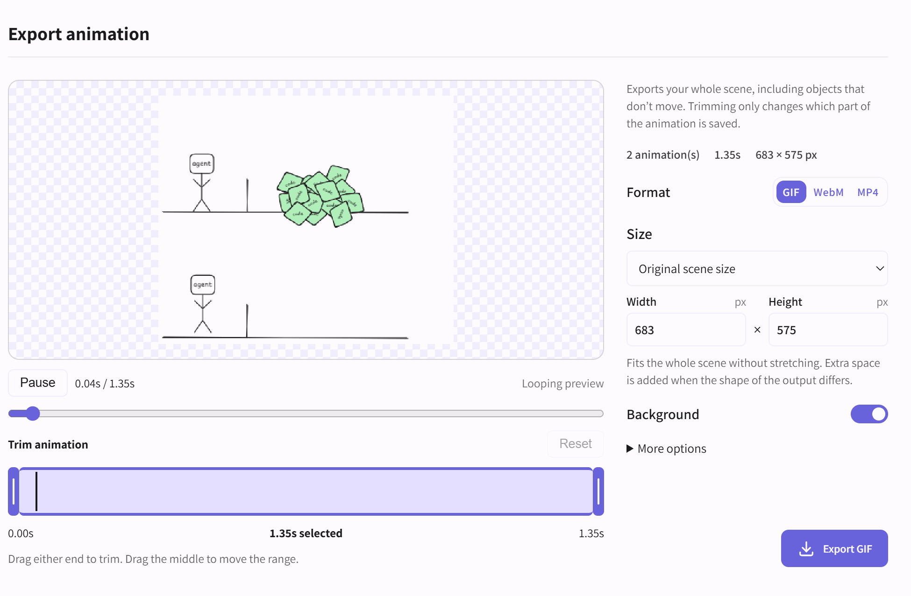

# excalidraw-animator

## Motivation

because the existing slop coded ones are literally unusable

- [https://animator-excalidraw.vercel.app/](https://animator-excalidraw.vercel.app/)
  - No undo option, clicking the optiosn on the right for animation resulted in weird behavior. Couldn't animate my stick man to jump. 
- [https://app.excalimate.com/](https://app.excalimate.com/)
  - Awful 
- [https://github.com/dai-shi/excalidraw-animate](https://github.com/dai-shi/excalidraw-animate)
  - Can't really edit the animation, it gives you a default animation where every piece of the diagram fades in 1 by 1. Also can't edit your diagram.

- [https://www.excalimotion.com/](https://www.excalimotion.com/)
  - 

 lipstick on a pig smh

## Usage

Press 'G' to record movement. Press 'G' again to stop.

Playback/edit/export in the toolbar at bottom.

```sh
docker pull ghcr.io/ashfordhill/excalidraw-animator:latest
docker run --rm -p 3001:80 ghcr.io/ashfordhill/excalidraw-animator:latest
```

Forked from [excalidraw/excalidraw](https://github.com/excalidraw/excalidraw).


<p align="center"></p>
<p align="center"></p>
<p align="center"></p>
<p align="center"></p>

## Feature Ideas

- Appear/disappear objects within animation
- Transitions (fade, rotate)
- Easier way of cloning and editing (e.g. - I want to animate a stick figure army marching along but at slightly diff positions)
- UI improvements in animation editor
  - Lots of whitespace rn but scene is cropped, soo. idk?
  - Moving/resizing panes inside editor


## AI Notes

- Claude (Opus 5.5) is king for UI
- Astra 6 ok but expensive. Sol, eh.
- DeepSeek V4.1 Flash 1017 horrible horrible horrible for UI